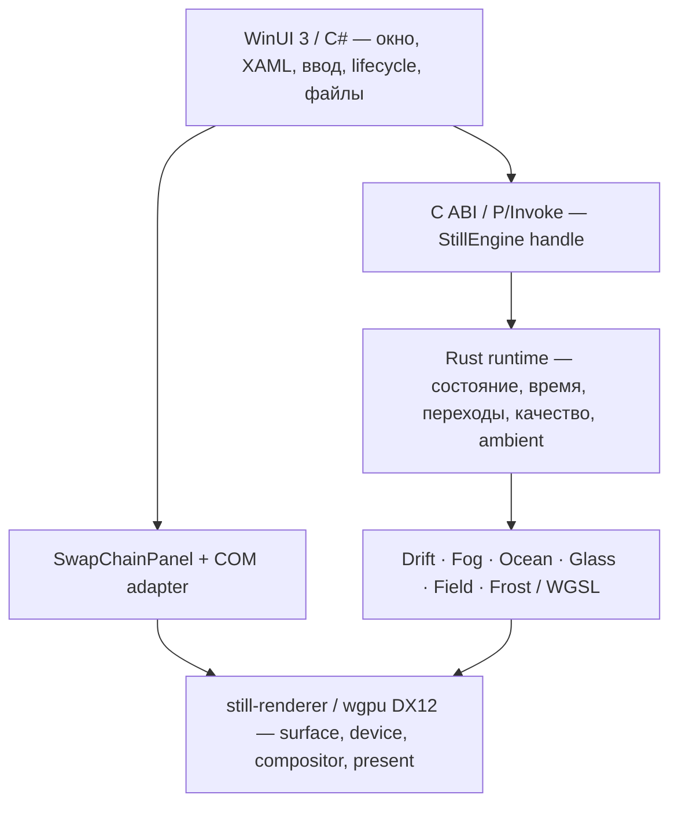

# Архитектура Windows

Решения для переноса Still 2.2. Состояние реализации — в
[точке входа](README.md); список этапов — в [плане](porting-plan.md).

## Граница общей части и платформы

| Объект или обязанность | Владелец |
| --- | --- |
| HWND, AppWindow, titlebar, fullscreen, оконная геометрия, системная тема | C# |
| XAML overlay, настройки, accessibility, Narrator, keyboard navigation | C# |
| Native pointer/power/display events, DIP и scale | C#; в Rust идут нормализованные данные |
| Чтение/атомарная запись файлов, пути, пользовательские сообщения | C# |
| Выбранная сцена, параметры, seed, пресеты, кодек состояния | Rust — источник истины |
| FrameClock, сглаживание, quality policy, input mailbox | Rust |
| Сценовые GPU-ресурсы, compute/render passes, WGSL | Каждая Rust-сцена |
| Instance/Adapter/Device/Queue/Surface, compositor, acquire/present | Rust renderer |
| Анализ звука, бас/ритм, синхронизация медиа и mapping в свет | Надстройка будущего плеера |

Core не импортирует Windows, WinUI, AppKit, HWND, COM или файловые пути.
UI показывает копию descriptor/state и посылает команды; собственную физику,
модель пресетов или правила диапазонов параметров в C# не создаём.

Тот же принцип оставляет путь к Linux/Android с Vulkan и отдельными нативными
hosts. Эти backend/platform paths пока не реализованы: сейчас явно выбираются
Metal для macOS и DX12 для Windows; на остальных OS renderer возвращает
UnsupportedPlatform. Кроссплатформенная часть — Rust-сцены и модель, а не общий UI.

## Существующие crates и файлы

| Место | Назначение и правило переноса |
| --- | --- |
| `crates/still-core` | Типы, валидация, clock, state, quality, mailbox, signals, ambient; без GPU/OS |
| `crates/still-scenes` | Контракт Scene, registry, шесть реализаций и их WGSL; сохранить IDs и код |
| `crates/still-renderer` | wgpu и compositor; native surface creation изолирован в `src/platform.rs` |
| `crates/still-ffi` | Действующий C ABI и пока runtime; panic containment, diagnostics, metrics |
| `include/still.h` | Генерируемый ABI-контракт, не редактировать вручную |
| `macOS`, `Still.xcodeproj` | Работающая SwiftUI/AppKit-оболочка и её сборка |
| `platforms/windows` | Место новой C#/WinUI-оболочки |
| `xtask`, `scripts` | Общие Rust-проверки и платформенные сборки |

Имена `still-render` / отдельный `still-scene-drift` из предложения — пример
декомпозиции, а не требование переименовать проверенные crates. На первом этапе
сохраняем layout. Если runtime выделяется, зависимости идут
`still-ffi → still-runtime → core/scenes/renderer`; платформенные COM-типы
остаются у surface adapter, не поднимаются в core.

## Создание и владение

Целевая последовательность Windows:

1. C# создаёт MainWindow, Grid и `SwapChainPanel`, активирует окно.
2. После Loaded получает правильный native interface панели через C#/WinRT.
3. Rust создаёт DX12 Instance и Surface, затем выбирает adapter с
   `compatible_surface: Some(&surface)`, создаёт Device/Queue.
4. Поверхность настраивается по реальным capabilities и физическому размеру.
5. Импортируется Rust content state, создаётся выбранная сцена, применяются
   параметры, качество и latest ambient snapshot.
6. После готовности ненулевого viewport подписывается кадровый callback.

Текущий `still_engine_create` создаёт adapter **до** attach; это macOS-маршрут,
а не реализация пункта 3. Для Windows потребуется отдельный create/attach
контракт или отложенная инициализация GPU. Нельзя поменять device, сохранив
сцены/ресурсы предыдущего device. Сначала доказать новый путь в W0.

Один native controller владеет одним engine handle и панелью. Все вызовы одного
engine сериализованы. До освобождения панели: отписать callback и producer,
дождаться текущего кадра, сохранить content state, suspend, убрать привязку
swapchain на UI-потоке, освободить сцены и Surface, destroy engine, отпустить
COM-ссылки; затем можно освобождать панель. Подробности в [interop](interop.md).

## Кадр, потоки и 60/120 Гц

Первая Windows-версия использует `CompositionTarget.Rendering`. Attach/configure,
вызовы движка и teardown выполняются последовательно на UI-потоке. Callback
передаёт **монотонный timestamp в секундах**, а не самовычисленный dt; общий
FrameClock считает фиксированные шаги. Повторный RenderingTime не должен
порождать второй кадр. При resume сбрасывается clock, а не догоняется сон.

Один кадр: забрать latest resize/settings/input → advance clock → scene prepare
→ compute/render активной и при переходе исходящей сцены → общий compositor
→ submit → present → лёгкая запись metrics. GPU-данные сцены не ходят в C#.

Simulation 120 Hz и максимум четыре шага уже реализованы. 60/120 Hz дисплея
не меняют скорость движения. Нельзя вводить независимый `sleep(16ms)` loop
или неограниченную очередь callbacks. Кадры приходят от display/XAML cadence;
ограничение частоты — native policy, не замена физического времени.

Сейчас из Rust ядра нельзя заключить, что WinUI callback выдаст 120 кадров/с
на любой системе: это измеряется на W0/W4. C# не создаёт отдельный render thread
на старте. Его можно добавить по результатам измерений, сохранив один владеющий
поток, coalescing и правила COM/UI-affinity. Вызовы XAML из фонового потока
не становятся допустимыми от наличия agile-интерфейса.

Важная особенность Rendering: постоянная подписка удерживает XAML в режиме
перерисовки. При остановке **отписывать событие**, а не только делать early return.
Это следует из [контракта Microsoft](https://learn.microsoft.com/en-us/windows/windows-app-sdk/api/winrt/microsoft.ui.xaml.media.compositiontarget.rendering).

## Сцены и GPU

| Сцена | Что переносится без платформенной переписи |
| --- | --- |
| Drift | GPU compute, 30k capacity, активный prefix, curl noise/force field, pointer wake; ping-pong trails |
| Fog | Fullscreen atmospheric volume, bounded ray integration, fBm; без particle simulation |
| Ocean | Indexed mesh, procedural displacement, analytic normals, Fresnel |
| Glass | Два оптических прохода, refraction/absorption/Fresnel, procedural background |
| Field | Compute-построение streamlines и ribbon render; без persistent particles/history |
| Frost | Два прохода: три площадных источника и матовое стекло; flexible ambient controls |

У каждой сцены свои shaders, pipelines, параметры, seed, четыре built-in preset
и ресурсы. Общий renderer получает линейный SceneOutput, а не знает физику сцены.
Переход 0.65 с удерживает максимум две полные сцены, потом исходящая освобождается.
Не удерживать шесть комплектов GPU-ресурсов ради мгновенного переключения.

Drift не становится CPU-симуляцией на Windows. Примеры attract/repel/vortex и
упрощённая формула noise из исходного плана — идеи, не новые требования.
Существующий pointer воздействует через поле сил, а не загрузкой позиций частиц.
Trails остаются time-based: decay зависит от dt, а не количества display frames.
GPU-ресурсы и uniforms остаются в Rust. Production readback или передача
Particle*/wgpu::Device*/Rust Vec через ABI не допускаются архитектурой.

## Ввод и ambient

WinUI события преобразуются в существующий `StillPointerEvent`: x/y в **−1…+1**,
ось Y вверх, velocity в тех же координатах/с, active как uint32. Для pointer в
DIP: `x = 2*xDip/widthDip − 1`, `y = 1 − 2*yDip/heightDip`.
Enter/move/exit/capture loss должны завершаться корректным latest state.
Не отправлять XAML event objects или копить все PointerMoved в очереди.
Модель pressure/kind/phase из предложения пока отсутствует в ABI; wheel/кнопки
добавлять только отдельным совместимым контрактом, если потребуется продукту.

Внешний свет — уже существующий атомарный snapshot трёх источников:
color, gain, offset, scale, rotation + общая brightness. Настройки времени
color/attack/release/transform доступны в коде, не в пользовательском UI.
По умолчанию 0.85 с; 0 отключает соответствующее сглаживание. Inputs transient,
не меняют preset или сохранённую ручную сцену. Только Frost сейчас их потребляет.

Надстройка плеера сама выделяет звуки/ритм и формирует значения. В ядре не нужны
именованные bass/mid/beat channels или PCM. Latest snapshot допускает потерю
промежуточных состояний: короткий beat адаптер превращает в огибающую, видимую
хотя бы одному кадру. Настройки передаются перед snapshot на frame boundary.
Пределы и ABI: [ambient-control-api.md](../ambient-control-api.md).

## Размер, DPI и поверхность

События SizeChanged и CompositionScaleChanged только обновляют **последний**
запрошенный viewport. Перед следующим кадром один resize/configure. Размеры
передаются физическими пикселями: round(ActualWidth × CompositionScaleX),
round(ActualHeight × CompositionScaleY), с проверкой конечности и диапазона.
Нулевой размер означает suspend/release targets, не `configure(0,0)`.

Физический backbuffer и XAML composition scale должны совпасть: проверить
необходимость `IDXGISwapChain2::SetMatrixTransform` с обратным scale.
В закреплённом wgpu-hal нет готового panel-specific DIP/scale setter. Простого
умножения width/height недостаточно, чтобы считать поддержку DPI доказанной.
В W0 выбрать узкий adapter/patch либо другую проверенную integration path;
масштабирование не должно проникнуть в сценовые WGSL.

Проверять 100/125/150/175/200%, перенос между мониторами, fractional DIP,
минимизацию и быстрый resize. При fullscreen C# меняет AppWindow/presenter,
Rust видит только новые viewport и lifecycle. Exclusive fullscreen и DXGI
Alt+Enter не являются дополнительной архитектурой окна.

Особенности WinUI: SwapChainPanel непрозрачен; Acrylic/backdrop sampling поверх
его содержимого не поддерживается. Для панели управления использовать
самостоятельный XAML фон. См. [официальный контракт панели](https://learn.microsoft.com/en-us/windows/windows-app-sdk/api/winrt/microsoft.ui.xaml.controls.swapchainpanel).

## SDR и качество

Использовать реальные surface capabilities: sRGB render target, FIFO, opaque,
desired_maximum_frame_latency = 2, sample count = 1. Если sRGB недоступен,
нельзя молча отправить линейный output в Unorm: нужен проверенный output-transfer
path и эталон градиента. Текущий compositor рассчитывает на sRGB target;
проверка DX12 формата и сравнение цвета с macOS обязательны в W0.

Без HDR/wide-gamut и MSAA на первом переносе. HDR требует отдельного ADR после
стабильных SDR, DPI, cadence, multi-monitor и sleep/wake. API «актуального wgpu»
из предложения не является API закреплённой версии 0.20.1.

Сохраняются **Eco / Balanced / High / Auto**, собственные budgets и Auto history
для каждой сцены. Частицы 100k+ и новые Efficiency/Quality из примера не вводятся.
Не сводить все сцены к particle-count. Актуальные бюджеты — в коде сцен и
[общих ADR](../architecture.md), измерения — в [performance](../performance.md).
В Windows измерить CPU submit, GPU time, present cadence, длинные gaps, RSS и
GPU memory; Metal baseline не является доказательством скорости DX12.

## Lifecycle и восстановление

Целевое состояние controller: Uninitialized → Initializing → Running;
Running ↔ Suspended; Recovering → Running либо Failed; любой этап → Closing.
Не считать такую машину уже реализованной Windows-функцией.

| Ситуация | Действие Windows host |
| --- | --- |
| Active + visible + ненулевой viewport | Подписка кадров, render |
| Minimized / hidden / screen off / system suspend | Отписать Rendering, suspend, очистить transient pointer |
| Inactive visible | Первая policy как macOS: suspend; дальнейшее снижение FPS — отдельное решение |
| Полное перекрытие | Остановить/снизить кадры при наличии надёжного native signal; это не wgpu error |
| Battery saver / power source | Native power signal → существующая policy, не изменение сохранённого preset |
| Resume / monitor changed | Сверить panel/device/scale, latest resize, reset clock, затем возобновить callback |
| Close | Сначала прекратить вызовы; затем ordered detach/destroy при живой панели |

В wgpu 0.20.1 SurfaceError: **Lost, Outdated, Timeout, OutOfMemory**.
Lost/Outdated → configure/retry при валидном размере; Timeout → skip и bounded log;
OOM → прекратить rendering и показать понятную ошибку. `Occluded` в этом enum
нет. Device lost требует отдельного восстановления всего GPU runtime с
повторным созданием ресурсов из content state; обычный surface reconfigure
не восстанавливает Device. Восстановление должно иметь ограничение повторов.

`SurfaceContentsLost` из предложения не принимается за событие SwapChainPanel:
найденный [официальный контракт](https://learn.microsoft.com/en-us/uwp/api/windows.ui.xaml.media.compositiontarget.surfacecontentslost)
относится к Windows.UI.Xaml.Media.CompositionTarget (UWP). Его нельзя автоматически
перенести в выбранный WinUI 3 host. Нужны проверенные на выбранном App SDK
wgpu/device/native lifecycle signals. Паника не пересекает C ABI; ошибка
возвращается статусом, детали забираются через существующий error/event export.

## Состояние, файлы и диагностика

Rust сохраняет scene IDs, per-scene seed/parameters/presets и выбранную сцену
через кодек schema v3, включая существующие миграции v0/v1/v2. Native host
сохраняет текст атомарно, держит копию повреждённых/будущих документов,
не подменяет Rust validation своими словарями.

Windows paths: отдельный каталог Still в LocalAppData; content JSON и device/UI
settings раздельно. Window rect/fullscreen, тема, cadence/quality preference и
power policy — native settings. Никакого Windows Registry или поиска AppData
в core. Transient ambient и временные envelopes на диск не пишутся.

Логи C# и engine в одном каталоге сессии (`windows.log`, `engine.log`);
адаптер/backend/driver, версия DLL, hash, viewport, scale, transitions и ошибки
пишутся для воспроизведения. При текущем ABI native host собирает error/event/
metrics exports; tracing/debug output — возможное развитие, не существующий
FFI logging callback. Не блокировать кадр дисковыми записями и не вызывать C#
обратно из render/audio producer. Не логировать каждый normal frame.
